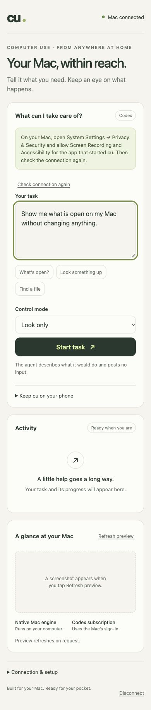
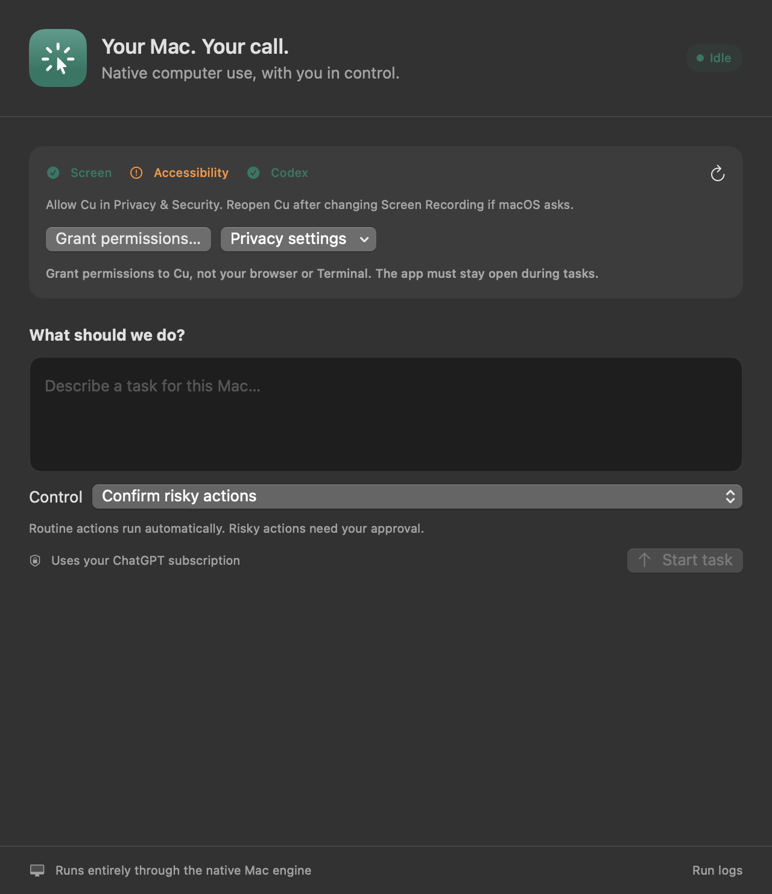
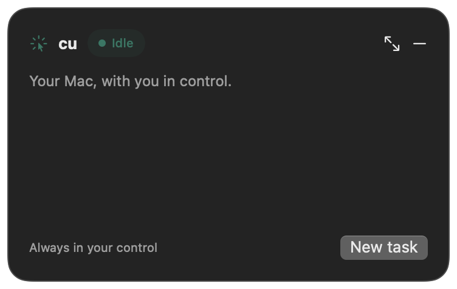

# Implementation status

Milestones from HANDOFF.md §17. Last updated 2026-10-30.

## Version 14 opt-in Allow all actions (installed)

- **Control → Allow all actions** explicitly selects engine `auto` for tasks started while selected.
  Send/delete/pay/command/sensitive-input approvals and provider-check prompts are skipped. No extra
  opt-in confirmation modal; the selector shows a persistent warning and is locked while running.
  Critical actions only remains the default, including on app relaunch; local config is unchanged.
- The host's effective mode is supplied to the planner and fresh verifier, avoiding invented
  permission questions in auto mode. Genuine ambiguity/login/uncertain delivery can still stop.
- Stop, human-interference pause, hard denials, exact typing-focus checks, run limits, private/public
  helper boundaries and evidence-based completion remain. macOS permissions cannot be bypassed.
- Known risky automatic input is marked before execution, including failed/uncertain posts; both
  format repair and completion recovery respect that no-replay barrier without human approval.
- **118 Rust tests**, strict all-target Clippy, **71 native passed/1 live metadata skipped**, nine
  backend, three Node and signing regressions passed. No physical input, WhatsApp task replay,
  Send or live inference experiment. Actual automatic desktop workflow remains unverified.
- Exact artifact `target/Cu-allow-all-staging/Cu.prepared` installed with the existing certificate,
  no TCC reset/request or login change. App CDHash `eac822daffa162d13208b7f14e51c73931aca8b5`;
  engine `902043b5cedca26bbddee4fbbc28da9929aef6e1`.
  Previous copy: `target/app-backups/20261030T003259.SNzFkk`.
- Actual GUI PID **77254**, 2026-10-30: Screen/Accessibility true at **00:33:00**, Codex ready/exit 0
  at **00:33:01**. App idle, no active engine. Notifications still not authorized; they are not needed
  for automatically allowed actions. Panel remains the fallback for human pause/other modes.
- Details: [ALLOW_ALL.md](ALLOW_ALL.md). Logs `target/allow-all-{rust-tests,clippy,native-tests,
  backend-tests,node-tests,signing-tests,build,install,gui-readiness}.log`.

## Version 13 native-app discovery and rejected-plan repair (historical deployment; retained in version 14)

- Diagnosed `20261029-180501-cb3fcfeb` (premature WhatsApp Web login blocker) and
  `20261029-180600-bd32f73d` (native app opened, then invalid focus-guard reply). No task replay.
- Native task starts supply at most eight task-matching app name/bundle-ID candidates from bounded,
  read-only bundle metadata to the private Codex planner/verifier, never public helpers. Native-first
  discovery honors explicit browser/profile requirements; a web login wall alone is not a blocker.
- Disjoint action schemas forbid non-type focus guards; the host still rejects the entire bad reply.
  One fresh-frame, budgeted repair per run, blocked after denied/approved input. Invalid-reply usage,
  latency and sanitized diagnostics are now retained. Stop wins before polling the repair request.
- Native WhatsApp bare Return/keypad Enter and typed newlines require approval where they may send;
  plain typing, Shift–Return and positively identified search remain routine. Classification remains
  best-effort, not a universal identity/delivery or consequential-action guarantee.
- **112 Rust tests**, strict all-target Clippy, **70 native passed/1 live metadata skipped**, nine backend,
  three Node and persistent-signing regressions passed. No live model/helper inference experiment,
  desktop input, WhatsApp task replay or Send. A read-only probe confirmed actual installed WhatsApp
  metadata is detected without app activation/account inspection. Real end-to-end behavior remains unverified.
- Installed exact `target/Cu-native-discovery-staging/Cu.prepared` with the same certificate; no TCC
  reset/request, account change or new permission migration. App CDHash
  `509b30e83da6bf9faf51dc25558dd343c50ec703`; engine `c1c61f4553e5cfee648350749b8cef181091107c`.
  Previous copy: `target/app-backups/20261029T185443.BNxev0`.
- Actual GUI PID **65588**: Screen/Accessibility true at **18:54:43**, Codex ready/exit 0 at **18:54:44**.
  App idle, no active engine task. Notifications explicitly **not authorized** at 18:54:43; enable Cu
  in macOS notification settings for banner actions. Existing panel approval remains available.
- Details: [APP_DISCOVERY_RECOVERY.md](APP_DISCOVERY_RECOVERY.md). Logs:
  `target/native-discovery-{rust-tests,clippy,native-tests,backend-tests,node-tests,signing-tests,build,install,gui-readiness}.log`.

## Version 12 critical-only approvals and notifications (historical deployment; retained in version 13)

- Critical-only (`confirm-risky`) is the native default and explicit local safety mode; normal
  tab/window closing is automatic. Navigation/field-help false positives reduced without bypassing
  consequential labels, credentials, unknown terminal execution, hard denials or human pause.
- Native notifications provide Approve/Deny or Resume/Stop. Body clicks open and reveal the exact
  request; opaque launch/run/prompt binding and single-use routing reject stale/duplicate responses.
  Existing focus restoration/engine revalidation is retained; fallback PID is captured before
  Notification Center activation. No private text is copied into notification content.
- 98 Rust tests/strict Clippy and 67 native tests passed (1 live metadata test skipped), plus backend,
  Node and signing regressions. Same-certificate prepared artifact installed; no TCC reset/request.
- GUI PID 36128: Screen/Accessibility true at 17:54:56, Codex ready at 17:54:57. One-time notification
  authorization requested at 17:54:56; user grant/delivery is not yet verified. No consequential
  action, desktop/email task replay, physical input or helper inference was performed.
- Details: [APPROVAL_NOTIFICATIONS.md](APPROVAL_NOTIFICATIONS.md).

## Version 11 hybrid helpers (retained in current version 14; public synthetic smoke passed)

- Fixed Luna-medium still plans desktop actions; argument-free standalone capabilities dispatch
  public-brief-only research to Parallel and content-free role/boolean metadata to Jev, only as needed.
- Separate native public brief, bounded attempts/timeouts, per-run success/failure cache, cancellation
  placeholder, untrusted public-source records, observed helper stages. No helper input authority,
  account/login change, new classifier, screenshot/private-task sharing, or relaxed screenshot gate.
- Version 11 installed from the exact prepared artifact, same certificate, no TCC reset/request or
  login changes. Actual GUI grants true at 16:29:37; Codex ready at 16:29:38 (PID 19874).
- Freshly authorized public/synthetic smoke: Parallel search + decision **1,508 ms** (4 HTTP attempts,
  6 retained sources), Jev metadata **127 ms** (1 attempt). 5 host-counted sends, no application retries, private
  context, desktop capture/input, research/email task replay or Send. Final transport also explicitly
  disables implicit protocol-NACK retries; no smoke requests were repeated. No real-task speed/quality claim.
- Current local validation: **96 Rust tests**, strict Clippy, **58 native tests passed/1 metadata test
  skipped**, 9 backend tests, 3 Node tests and persistent-signing regressions passed.
- See [HYBRID.md](HYBRID.md) for exact privacy boundaries, validation and live-smoke opt-in.

| Milestone | State | Notes |
|---|---|---|
| M0 Toolchain & skeleton | ✅ done | `cargo build` builds/links the Swift static lib; `cu --version` reads the ABI over FFI. |
| M1 Display, permissions, one-shot capture | ✅ exercised in user-driven runs | `cu doctor/display/cursor/screenshot`; SCScreenshotManager → vImage resize → ImageIO. Recorded real screenshots in user-driven tasks; isolated edge-case tests remain pending. |
| M2 Input primitives + CuTarget | ✅ move/click live verified; other primitives pending | Seven inert-window actions, 15 native posted events matched independently received events, single/double/right clicks. No keyboard/scroll/drag physical test. Broader tests in `live_cutarget.rs` remain ignored. |
| M3 Coordinate mapping + mock agent loop | ✅ done (unit), ⏳ full live check | `CoordMapping`, executor, recorder, `MockProvider`; 37 agent-loop tests, including wrong-field typing guards and helper privacy/authority/approval-deadline boundaries. Live model-driven task-speed improvement remains unverified. |
| Mobile dashboard + Codex subscription | ✅ implemented, ⏳ permissions / phone access | `cu serve`, responsive UI, private pairing, progress, confirmations, stop, preview. Persistent Codex app-server planner, ChatGPT-only auth; default routes model and reasoning every planning turn. Native control from the UI still needs Mac permissions; LAN activation is pending explicit approval. |
| Native attached menu-bar panel | ✅ version 14 installed, ⏳ live workflow | One transient, non-detachable popover below the status icon. No separate controls window or draggable task overlay. Stage/step/input counts, approvals, stop, live auth readiness, completion findings, logs. Both grants survived a same-certificate update; see `docs/SIGNING.md`. |
| Dynamic OpenAI model + reasoning router | ✅ implemented and installed | Every-turn screenshot/task/outcome classifier; Luna-low / Astra-medium / Astra-high, validated catalog fallbacks and bounded reasoning. Explicit per-turn overrides, persistent planner history, UI/event metadata. Synthetic live Luna→Astra switch verified. Current operator override: fixed Luna-medium with no classifier. |
| Completion verification + profile recovery | ✅ included in installed version 14, ⏳ live workflow | Explicit terminal states, fresh evidence-based Luna review, one bounded recovery, no consequential-action replay, accurate Needs your input UI. Version 5 was prepared only; its changes are now included in version 9. See `docs/COMPLETION.md`. |
| Persistent local signing | ✅ installed and live-verified | One code-signing-only Keychain certificate for app + engine, pinned designated requirements, fail-closed build/install guards. Explicitly authorized Cu-only migration/reset once; real version 7 → 8 update retained both grants without another reset/reapproval. |
| M4 Anthropic provider | — | `cu run --provider anthropic` errors with "not implemented (M4)". |
| M5 Safety v1 | partial | Policy/modes, hard-deny, confirmations, limits, `release_all`, cursor-delta pause, native global stop. Approval restores exact app focus and engine revalidates AX focus/target/display identity. Missing: engine event-tap watchdog/panic hook and atomic screenshot/content verification after confirmation. |
| M6–M10 | — | Swift entry points exist and return `CU_ERR_UNIMPLEMENTED` naming the milestone. |

## Verified so far

- `cargo test --workspace`: **98 passed** (25 core, 35 provider/router/protocol/helper, 37 agent loop, 1 bounded-diagnostic test); 2 broad physical-input and 2 subscription integration tests ignored by default.
- Native version-12 tests: **67 passed**, 1 live metadata check skipped. Actual installed GUI metadata readiness was separately verified. Version 10 previously passed all 56 including its opt-in live metadata test.
- Optional web bridge and decision-benchmark offline tests: passed.
- `swift test` in `swift/CuMac`: **9 passed** (2 XCTest, 7 Swift Testing).
- `cargo clippy --workspace --all-targets -- -D warnings`: passed.
- Explicitly authorized inert-window pointer test: **7 actions, 15 posted/received events, 4 click ripples**;
  correct single/double/right button counts, ≤1 point coordinate error. Validator format correction
  rechecked saved receipts without repeating input. No keyboard, browser/email action, capture or
  model inference. Final window-pool refinement is stress-tested synthetically; the engine code is unchanged.
- Version 12 is installed with both GUI grants and Codex readiness verified. New notification authorization is separate and pending user grant. No research/email task
  was retried, and no end-to-end performance improvement or post-send verification is claimed.
- Persistent signing regression tests passed: changed app/engine hashes retain the prior requirements;
  ad-hoc, identifier-only, and unconfigured identities are rejected. Real version 7 → 8 update retained
  `screen=true accessibility=true` at **13:31:23**, with no reset/request/reapproval during that update.
- Live Luna-only completion check passed on a synthetic 1px image: supported read-only result
  verified (2922 ms); unsupported research/email success claim rejected (4187 ms).

## Deviations from HANDOFF.md

- **Native GUI now available:** the original CLI-only v1 scope was expanded with `tools/CuApp`. Version 6 uses only an attached menu-bar popover; the earlier separate window/floating task overlay were removed at the operator's request. CLI and optional phone dashboard remain available.
- **ABI version 2:** thread-local, synchronous posted-pointer observation; borrowed callback lifetime
  is bounded to execution and clears on every exit. It cannot authorize or inject input.
- **ABI additions:** `cu_init()` (must run on the main thread, builds the keyboard layout map since
  Text Input Source APIs need the main thread), `CU_ERR_*` status codes, `CU_PERM_*` bits. Layout
  guards (`_Static_assert` in cu.h, `const assert!` in Rust) pin struct sizes.
- **Key combos across the ABI** use a canonical form (`"shift+cmd+t"`, `"return"`, `"plus"`);
  `cu-core::keymap` normalizes both providers' names into it.
- **`HoldKey`/`Wait`** carry `duration_ms` instead of `Duration` (clean JSON for scripts/logs).
- **CuTarget** is AppKit, not SwiftUI, so view frames in global points are exact.
- **Settle detection** falls back to a fixed `settle.fallback_ms` (300 ms) until M7.
- **Human-input detection** uses the cursor-delta fallback only until the event tap lands (M5).
- **Keyboard layout map** is built once at startup; it is not yet rebuilt on input-source change.
- **Policy (M5) landed early** as pure classification logic so that mock runs on the real Mac
  already respect modes and confirmations.

## ⚠ Still to verify empirically

- Scroll sign conventions for line and pixel units (the live test asserts "positive dy scrolls content down").
- SCK completion handlers firing without a main run loop (one-shot capture path).
- Which permission the watchdog event tap needs on macOS 27 (M5).

## Mobile dashboard validation (2026-10-27)

- Rust workspace: 36 tests passed; two real input tests and one subscription integration test ignored by default.
- Dashboard integration check: passed authentication, cross-origin rejection, payload bounds, single active run, streamed state, stale approval rejection, stop/EOF handling, and a subsequent run, using a fake native child.
- Optimized release build and strict workspace Clippy: passed.
- Local Codex app-server metadata probe: ChatGPT subscription and image-capable models available.
- Actual browser preview verified at 320px, 390px, and 1280px without horizontal overflow; task suggestions and control-mode changes verified.
- Live Codex test passed with a valid synthetic 1px PNG: GPT-6 Luna, first reply 3093 ms, reused-connection reply 1001 ms. These tiny test replies do not predict real task latency.
- Mac readiness observed through the dashboard: Screen Recording ready, Accessibility needed, ChatGPT subscription signed in. Adam’s ownership of that sign-in is unverified.
- Full live screen/control testing still requires Screen Recording and Accessibility permissions.
- Jev: no service, source, or API was identified. Dashboard backend is the new Node bridge to the existing Rust/Swift engine.

## Native app validation (2026-10-28)

- Built and installed the ad-hoc-signed bundle at `~/Applications/Cu.app`; `codesign --verify --deep --strict` passed.
- `swift test --package-path tools/CuApp`: 14 tests passed. Coverage includes run/prompt-scoped approval routing, stale events, stopping during a pending approval, waiting for child exit, bounded output, byte-split Unicode NDJSON, a synthetic approval/summary round trip, literal task arguments, EOF handling, spawn failure, and forced process-group/descendant cancellation.
- Native smoke check passed: controls and overlay visible, floating window level, nonactivating panel, menu installed, bundled engine present, global stop hotkey registered. Rendered the app's own views (not the user's desktop) to inspect layout.
- Regression checks passed: Rust workspace 36 tests (3 live tests ignored), Swift CuMac 6 tests, optional web bridge integration test.
- Observed readiness: Screen Recording and Codex sign-in ready in the smoke-test context; Accessibility still needs the user's grant. The independently launched app checks its own permissions again. No real input task was started by this validation.
- CLI and web dashboard are retained, but the previously started web server was stopped. The native app was opened with task controls and overlay visible.
- Limitations: local ad-hoc signing, no login-item autostart, and no cross-frontend run lock. Existing engine safety/watchdog limitations above still apply; the global stop shortcut belongs to the running native app, not a new engine-level watchdog.

### Performance / native pointer pulses (2026-10-29, version 10)

- Inspected `20261029-135552-2e3dde1e` without replay: 177.6s wall, 123.9s planning; 51.6s of
  planning corrected compose-field errors. Send was declined; this was an unsent draft, not delivery.
- Owner chose both decision-service benchmarks, brief pulses, and an inert-window-only live input test.
  Twelve synthetic decisions each: Jev median **79.5 ms**, Parallel **512.5 ms**, **6/12** expected
  advisory choices each in this setup. No private run data sent. No live integration, account/login
  changes or model-setting changes. [Details and raw synthetic results](PERFORMANCE_CURSOR.md).
- Added optional exact AX typing-focus guard, application-focused AX fallback, explicit compose-field
  focus instructions, and guidance against habitual extra waits. Existing 300ms settling and all
  policy/approval/completion boundaries remain; no measured real-task speedup is claimed.
- Native tagged-event feedback includes intermediate drag positions, repeated moves, button-down,
  actual click action releases and counts. Brief independent ripples use a fixed eight-window pool;
  a stress test caught and eliminated transient unbounded AppKit window allocation.
- Installed exact tested artifact `target/Cu-speed-staging/Cu.prepared` using the same certificate;
  final app CDHash **`9a61c60bcb303e48aafcbb230a08e4f0748c99e7`**. Live-tested engine code
  is unchanged (CDHash `9677f02338cdefe3b603c46245725d4fcd688ee9`). GUI PID 82683 logged
  **both grants true at 14:42:10**, **Codex ready/exit 0 at 14:42:11**. No identity migration
  flag, TCC reset/request, permission reapproval, or login change. Version-9 backup:
  `target/app-backups/20261029T143301.yDwKVP/Cu-system.disabled`; pre-pool version-10 backup:
  `target/app-backups/20261029T144209.rBHaqm/Cu-system.disabled`.
  Live input records: `target/speed-pointer-live-artifacts`; no research/email replay.

### Native Codex status stream fix (2026-10-29, 13:49)

- Reproduced the reported false login/timeout message: version 8 combined stderr warnings with stdout JSON before decoding. The engine actually returned exit 0 / `ready=true`; an unrelated `ultrafast_mode` warning invalidated the merged buffer. No login change was necessary.
- Added shared `CodexReadinessProbe` with separate bounded streams, preserved real structured failure reasons, fail-closed protocol/exit handling, and distinct timeout/malformed-response messages. Added safe OSLog readiness/exit/byte-count metadata, not raw credentials/output.
- 52 native tests passed including the opt-in live metadata check through the native transport; 70 Rust + 7 backend, strict Clippy, web and signing regressions passed. No model turn, task retry, or desktop input.
- Installed exact tested **version 9**, hash `937744222f351edbcd0c903d2843ff6fd3d73efe`, from `target/Cu-status-staging/Cu.prepared` using the same certificate. No migration flag, TCC reset/request, permission reapproval, or login change. Version 8 backup: `target/app-backups/20261029T134945.FNBH91/Cu-system.disabled`.
- **GUI process verified:** at **13:49:45** both permissions true; at **13:49:47**, `ready=true exit=0 timedOut=false stdoutBytes=98 stderrBytes=326`. The exact warning that previously broke status is now correctly separated. Details: [CODEX_READINESS.md](CODEX_READINESS.md).

### Persistent signing and permission-retention fix (2026-10-29, 13:31)

- Diagnosed repeated approval failures: ad-hoc designated requirements were exact changing `cdhash` values. TCC compared the old version-4/6 hash with each rebuilt app and rejected both permissions.
- Operator selected a reusable local certificate in login Keychain and explicitly authorized installation plus a **Cu-only** one-time reset. Completed manual **Code Signing only** trust approval; other certificate trust policies/apps remain unchanged. Private key stays in Keychain; public fingerprint is saved in `~/.config/cu/signing-identity`.
- Build/installer now sign both app and engine using pinned certificate-backed requirements. Missing/invalid identity, ad-hoc artifacts, identifier-only requirements, and implicit identity migration fail closed. Installer supports exact prepared artifacts without rebuilding/re-signing, checks prior identity compatibility, preserves backups, and has rollback handling. No routine TCC reset or automatic key generation.
- Signing regressions pass with changing app/engine contents and identical requirements; default installer was verified to reject version-6 → 7 migration until explicitly authorized. 70 Rust + 40 native + 7 backend tests, strict Clippy, web integration, and own-view smoke checks pass.
- Installed **version 7**, hash `eb5bb0719dbef53f5d1e9b4aa838369f5d2e8598`; reset only `Accessibility` and `ScreenCapture` for `dev.ankojh.cu` once. Owner manually approved both; native app logged both true at **13:29:18**.
- With separate owner approval, installed a **version-number-only version 8 update** using the ordinary installer, same certificate/requirement, and byte-identical engine. Hash changed to `a9c039dc83e0ca3b34e0481848b47ec761703ec0`. **No reset, request, or reapproval.** Native app and fresh LaunchServices helper confirmed both permissions true at **13:31:23**; live Codex account/catalog check passed.
- Current artifact: `target/Cu-stable-update-staging/Cu.prepared` → `/Applications/Cu.app`. Certificate selector: `42049CB9AE1C7428797C11D3F9F678BA831700B8`. Version 7 backup: `target/app-backups/20261029T133123.RRNiii/Cu-system.disabled`; version 6 backup: `target/app-backups/20261029T132737.BksygT/Cu-system.disabled`.
- No actual task, desktop input, or email was attempted. Routine local updates should retain grants, but certificate loss/rotation/expiry or macOS policy changes can still require consent. Full details: [SIGNING.md](SIGNING.md).

### Attached menu-bar panel + authentication repair (2026-10-29, 10:53; historical version 6)

- Both latest runs (`20261029-102612-5b4fb409`, `20261029-102637-9a98a8fc`) failed before planning/input: `workspace routing discovery unauthorized (401)` from Codex `account/read`. Zero steps/actions/confirmations; not a completion-verification refusal or permission error. Cached `codex login status` was misleading.
- Implemented live account/catalog readiness, one bounded authentication refresh, actionable Sign-in needed/runtime errors, and persistent cause display. Subsequent prepared/installed live checks report `ready=true`; no interactive login or account switch was performed.
- Replaced controls/overlay with a single transient, non-detachable popover below the status icon. Added host-observed execution stage, planning step, and posted-input count. No guessed percentage. Approval uses focus restoration plus independent engine focus/AX target/display revalidation; agent input into its own panel is denied.
- 70 Rust + 40 native + 7 backend tests, strict Clippy, optional web integration, prepared and installed own-view smoke checks pass. No real task replay or email send.
- Operator explicitly selected installation after testing despite potential ad-hoc grant disruption. Installed the exact tested **version 6** at `/Applications/Cu.app`, hash `e1257529c64c7efeb1f1fd3a3790a1f5b82ff826`, without rebuilding/re-signing between test and copy. Prepared artifact: `target/Cu-menu-staging/Cu.prepared`. Version 4 backup: `target/app-backups/20261029T105336.KorhaV/Cu-system.disabled`.
- **Remaining blocker:** launch logged `screen=false accessibility=false` at **10:53:38**. User reapproval is needed; no TCC reset or permission request performed. App remains idle in the menu bar; full desktop workflow is unverified. See [MENU_BAR.md](MENU_BAR.md).

### Completion verification and navigation repair (2026-10-29, earlier version-5 preparation)

- Inspected run `20261029-003331-55d09610`: it stopped at an unverified Chrome profile without research/email actions, but the empty action list incorrectly yielded `done`. No task was retried.
- Operator clarified: remove **routine navigation prompts only**, retain Send/consequential approvals, and leave macOS grants untouched.
- Implemented explicit `continue` / `complete` / `needs_input` planner states; complete/blocked claims go through a fresh, tool-disabled reasoned review of actual action outcomes and host-recorded screenshots. The selected model remains Luna-medium with no per-turn classifier. Valid evidence is required for success; recovery is bounded to one replan and cannot repeat approved/denied consequential actions.
- Profile instructions now require inspecting available Chrome profiles before asking the user to switch, and distinguish Chrome profile from Gmail sender identity. Native state/controls show requirement/evidence findings and retain a real Needs your input reason instead of Finished.
- Exact global app-switch/Spotlight shortcuts no longer prompt in confirm-risky mode merely because Settings is focused. Confirm-all and hard denials still win; Send/submit keyboard shortcuts remain approval-gated.
- All 64 Rust + 31 native + 7 backend tests, strict Clippy, web integration, and a three-call Luna-only synthetic live check passed. Validation details and bounds are in [COMPLETION.md](COMPLETION.md).
- Strictly verified **version 5** is prepared at `target/Cu-completion-staging/Cu.prepared`, hash `c143494ee949ac33755fd51b9465bab7de7b409a`. **Not activated:** the installed version 4 remains unchanged at hash `40c3ddb99edb225f8390992ce5b4c151111c2ebb`, with both permissions ready at its last launch. No TCC reset/request or app replacement was performed. A new ad-hoc installation could invalidate grants again, so activation is deferred.

### Shared cursor highlight and speed benchmark (2026-10-28, 22:44)

- Operator chose **benchmark before changing models** and a **highlighted shared desktop cursor**, not independent pointer control. No Jev/Parallel integration was added.
- [18 synthetic planner calls](benchmarks/2026-10-28.md), six each of fixed Luna-low, Luna-medium, Astra-medium: median planner times **2.350s / 2.631s / 4.135s**. Button-location/recovery and explicit profile-mismatch checks passed on these easy fixtures. Low versus medium was close; no desktop performance or safety guarantee is implied. Active model config was not changed.
- Implemented typed cursor feedback from resolved global Quartz points (including drag destination), cyan arrow/ring with Cu label, orange pending target, click-through/nonactivating/accessibility-hidden panel, completed-action fade, and state cleanup on pause/stop/done/stale runs. Added a persisted visibility toggle. Physical pointer and human-interference pause remain shared/unchanged.
- ScreenCaptureKit now explicitly excludes Cu's application windows, so cursor/control feedback does not contaminate model screenshots. Policy denies hits on Cu's own windows as a fallback against feedback obscuring risky-target inspection. Live SCK/AX overlay interaction still needs verification after installation; unit/property checks are not proof of live behavior.
- **53 Rust + 29 native + 7 Swift backend tests**, strict Clippy, and web integration passed. Tested mapped coordinates, declined targets, own-overlay denial, state isolation, Retina/negative/stacked screen geometry, nonactivating/click-through properties, and offscreen rendering.
- Built and strictly verified **version 4**, prepared at `target/Cu-cursor-staging/Cu.prepared` (CDHash `40c3ddb99edb225f8390992ce5b4c151111c2ebb`), deliberately not `.app` to avoid a duplicate launchable identity. Render-only preview: `docs/native-agent-cursor.png`. No staging readiness probe or real input was run.
- After reviewing results, the operator explicitly selected **Luna-medium, no classifier**, and approved installing the cursor update. Created private `~/.config/cu/config.toml` with `[codex] routing="fixed", model="gpt-6-luna", reasoning="medium"`. This applies to future runs; no live task was started.
- Installed **the exact tested version 4 artifact** at `/Applications/Cu.app` without rebuilding or re-signing. Verified unchanged prepared/installed hash `40c3ddb99edb225f8390992ce5b4c151111c2ebb`. Version 3 is preserved at `target/app-backups/20261028T225311.NZubMq/Cu-system.disabled`. Native smoke check passed, including an own-view cursor preview.
- The new launch reported both grants unavailable at **22:53:13**, after version 3 had been approved. With separate explicit permission, quit idle Cu, successfully reset **only** `Accessibility` and `ScreenCapture` for `dev.ankojh.cu`, then reopened the unchanged version 4 and Accessibility settings. The user later approved both grants; the relaunched version 4 reported `screen=true accessibility=true` at **2026-10-29 00:32:28**. Version 5 was subsequently prepared separately without changing the installed version 4.

### Dynamic routing validation and installation (2026-10-28, 22:12)

- Installed and registered **bundle version 3** at `/Applications/Cu.app`; strict signature verification and the native smoke check passed. The previous idle app was stopped only after checking that no native engine task was running. Version 2 is preserved at `target/app-backups/20261028T221234.2CaMHw`.
- Dynamic routing is the default for the app/CLI: routine → Luna-low; deliberate → Astra-medium; complex/recovery → Astra-high. Actual availability, image support, and supported efforts are validated. Unavailable explicit pins and invalid routing fail closed. No max/ultra reasoning or model-initiated delegation is enabled.
- Separate ephemeral classifier context per planning turn (20s deadline, bounded recent proposals); a persistent planner conversation retains history across model switches. Both model and effort are explicitly supplied on every planner turn. Actual action failure enforces the high-reasoning tier in dynamic mode.
- Native controls/overlay and optional web activity receive a structured `route` event. `model_response` records actual model plus route, router identity, brief explanation, and classifier/planner timings. Reported classifier + planner token usage is combined; dollar cost is not estimated.
- Added `--routing`, `--reasoning`, optional model/classifier pins, and documented fixed-mode escape hatches. Kept approval policy, execution engine, and user-controlled macOS grants unchanged.
- Deterministic stdin/stdout app-server tests cover every-turn reclassification, upgrades and downgrades, persistent planner thread, explicit overrides, fixed mode, pins, usage, malformed router output, and rejected tool requests. Agent/native tests verify that route metadata cannot approve an action. All **50 Rust + 22 native tests** and strict Clippy passed; the web integration check passed.
- Live subscription test used only a synthetic 1px image and no platform input: **Luna-low → Astra-high** recovery worked. Classifier calls took 2246/2446 ms; planners took 2531/2515 ms. These small synthetic replies are not a desktop latency benchmark. Every-turn classification adds an inference call.
- Live app at **22:12:36** reported **`screen=false accessibility=false`** after installation, unlike version 2's grants below. Follow-up TCC logs confirmed stale code requirements for **both** services: saved hash `b87743ecd147ed625a3e92421e198cf24feca9ef` versus installed `4c6f33f239497652e1d54a380a506b113138edf5`. Manual re-add did not clear them.
- With fresh explicit operator approval, quit idle Cu and successfully ran `tccutil reset Accessibility dev.ankojh.cu` and `tccutil reset ScreenCapture dev.ankojh.cu`, then reopened the unchanged installed app and Accessibility settings. No other apps' grants were reset; no rebuild/re-sign was performed. The user then reapproved both grants: the relaunched version 3 logged **`screen=true accessibility=true` at 22:21:52**.
- Stronger instructions require visible evidence for requested Chrome profiles/sender identities, but a deterministic profile/account prerequisite guard is still not implemented. Model routing alone does not guarantee compliance.

### Installed permission-flow repair (2026-10-28, historical version 2)

- Installed and LaunchServices-registered the corrected build (bundle version 2) at `/Applications/Cu.app`. Previous user-folder and staging copies are preserved under `target/app-backups` with non-`.app` suffixes.
- Permission probes and individual requests now run in bounded children using the same signed app executable, not on the UI thread. Checks time out after 4 seconds, requests after 20; unknown/timeouts are not displayed as denied. Repeated requests are coalesced; stale/cancelled responses are ignored. Status refreshes after returning from Settings and while setup is incomplete.
- Added native setup diagnostics, actual bundle path, a Finder reveal action, and separate Accessibility/Screen Recording buttons. No private entitlements, automatic TCC resets, or programmatic permission grants.
- `swift test --package-path tools/CuApp`: **20 tests passed**, including six new permission-service tests for success, simulated stuck calls with a responsive main queue, timeout, coalescing, cancellation/stale callbacks, malformed output, and missing executable.
- The installed app's signature verifies. A live process sample showed the main thread in AppKit's event loop, not blocked in a permission API.
- **Confirmed root cause of the enabled-but-not-working Accessibility switch:** TCC logged `Failed to match existing code requirement` for Cu's Accessibility grant, comparing an older ad-hoc build hash to the current installed hash. Screen Recording was granted and detected correctly. This is a stale grant, not evidence that the app needs a private entitlement.
- With explicit operator permission, ran **only** `tccutil reset Accessibility dev.ankojh.cu`; it succeeded. Screen Recording and other apps' permissions were not reset. The user reapproved Accessibility for `/Applications/Cu.app`; the live app then logged **`screen=true accessibility=true` at 21:25:32**, confirming both grants are detected from the installed app. No further rebuild/re-sign was performed. Future local ad-hoc rebuilds may need reapproval too.
